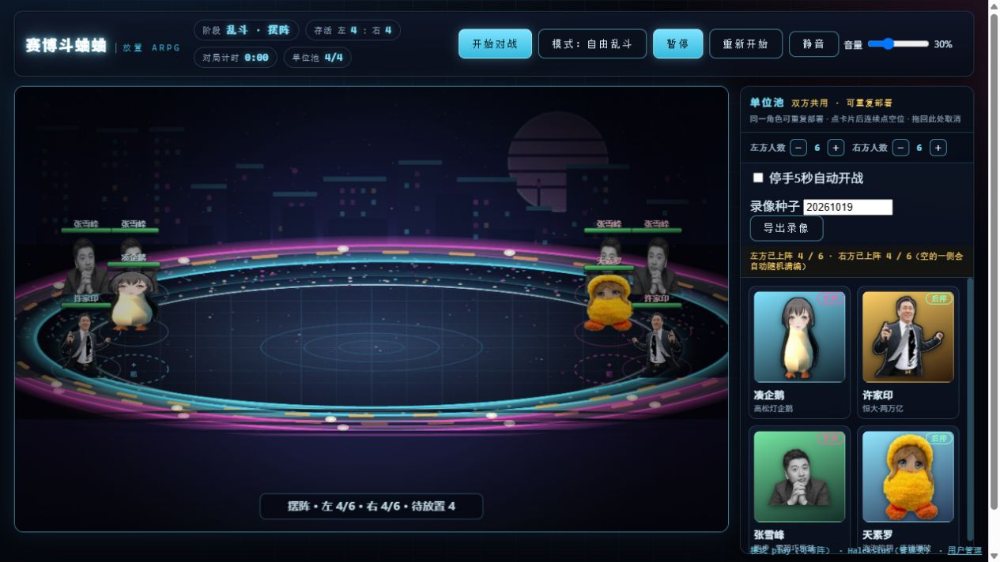
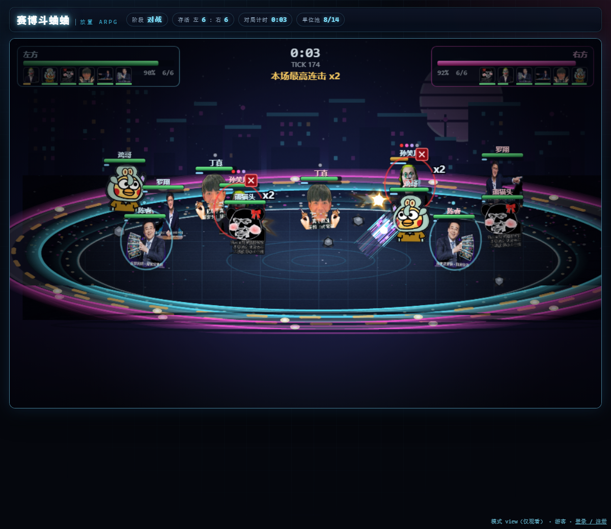
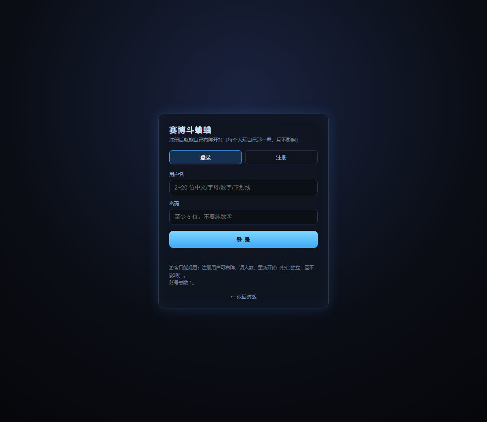
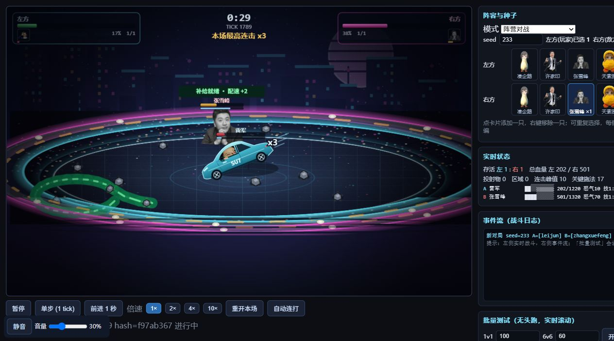
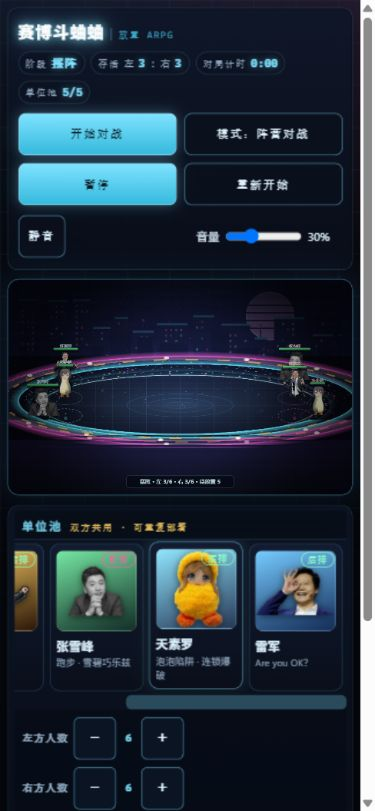

# 赛博斗蛐蛐 · 放置 ARPG（贴图版）

一群网络梗人物被塞进赛博蛐蛐罐里互殴。**实时动作战斗、全程自动演出**，你只需要把角色摆进场、然后看戏。

> 纯前端游戏（原生 JS + Canvas，零依赖、无构建），附一个 Node 静态服务器与**可选账号系统**：
> 游客只能看，注册用户可以自己布阵玩自己那一局，管理员可管理账号。



| 游客视角（只能看） | 注册 / 登录 |
|---|---|
|  |  |


## 玩法

| 交互 | 操作 | 说明 |
|---|---|---|
| **放置单位** | 从单位池把卡片拖到场地槽位 | 双方共用角色池，可重复部署；拖到已有角色的位置可替换，场上互拖交换；拖回池中撤下 |
| **暂停 / 继续** | `空格` 或右下角「暂停」按钮 | 冻结模拟、动画、技能 CD、buff、怒气、倒计时与音频；恢复后从暂停那一刻精确续跑 |
| **重新开始** | 「重新开始」按钮 | 回到布阵阶段，保留两侧布阵与人数 |

其余全部自动：

- 布阵完成后点击顶部 **开始对战**；可勾选「停手5秒自动开战」，放满或替换后同样保留调整时间
- **游客自动观战**；玩家点击开始时，空的一侧会随机补满
- 战斗阶段零输入（没有倍速、没有跳过、没有应援）
- 对局结束后可持续查看完整战报，点击「返回布阵」或「再来一局」；自动模式及观战者停留3秒后连场

### 场地与站位

己方 6 个槽位（3 列 × 2 排）：

- **前排**（靠中间）：吃伤害，适合坦克/近战
- **后排**：伤害 ×1.15，但受近战伤害 ×1.3，适合远程/辅助

开局双方**相距 800**（前排距中线 400、后排 480），不是贴脸开局。

1 只对 1 只就是经典单挑；多只上阵就是团战。

### 胜负与节奏

- **没有时间上限**，也没有"时间到按血量判胜"：只有一方被全部打倒才结束
- 也没有任何"拖久了自动加伤害"的机制
- **没有平A**：所有输出都来自技能（技1 / 技2 / 必杀，凑企鹅另有独立飞踢）
- **技能有蓄力前摇**：技1 0.5s / 技2 0.8s / 必杀 1.4s；蓄力期间挨到"有效伤害"（≥1.5% 最大生命）会被**打断**（霸体免疫），必杀被打断掉 60 怒气
- 节奏旋钮：全局伤害 ×0.72、技能伤害补偿 ×5.3、全局续航（回血/护盾/吸血）×0.72；所有模式使用相同的角色数值
- 单位之间**有体积互斥**，不会叠在一起；进射程后不会呆站，而是**绕圈找机会**；场地边缘有软排斥，不会被逼到墙角堵死
- 对战时间按 `tick / 60` 计；平衡与回放验证见 [最新验证记录](docs/AI-VALIDATION.md)。

## 运行

```bash
cd cyber-cricket
node server.js          # 默认 8130，占用会自动顺延
# 打开 http://127.0.0.1:8130
```

纯静态、零依赖、无构建步骤；桌面浏览器 + 鼠标键盘。

顶部「静音」按钮与音量滑条可随时调节声音，默认总音量 30%，设置会在本机浏览器保留。战斗音效限制重复触发与同时播放数量，角色台词最多每 3 秒一次。

## 阵容（五位）

| id | 名称 | 定位 | 技1 | 技2 | 技3 | 必杀 |
|---|---|---|---|---|---|---|
| `tomori` | 凑企鹅（高松灯企鹅） | 收集型坦克 | 企鹅拾荒 | 丢石头 | 企鹅飞踢 | 乱石雨 |
| `xujiayin` | 许家印 | 弹道输出 | 指点江山 | 债务标记 | 空城计 | 两万亿 |
| `zhangxuefeng` | 张雪峰 | 跑道控制与冲线 | 跑步·十公里结算 | 雪碧巧乐兹 | — | 全力跑步·最后一圈 |
| `tiansuluo` | 天素罗 | 泡泡控制与连爆 | 泡泡快递 | 泡泡陷阱 | — | 连锁啵啵 |
| `leijun` | 雷军 | 音波打断与驾车冲撞 | Are you OK？ | 交个朋友 | — | SU7，启动！ |

先前其他角色及隐藏 Boss 已移除。五位角色都可以重复上阵，每侧人数为 1～6。

## 特色技能

| 角色 | 机制 |
|---|---|
| 凑企鹅 | 场上持续刷新石头 → **默认就跑去捡**（会挑远离敌人的落点；敌人贴脸 70px 内、自己血 <30%、或 6 秒没打出伤害时才先打架）→ 攒到 4 块以上就**一块块抛出去**：石头是**抛物线投掷物**（从手里飞到落点），落地范围伤害；必杀先把全场石头磁吸过来再下更大的雨 |
| 许家印 | 「债务标记」让敌人受伤 +30% → 必杀**先引力把敌人拽过来**再连本带利引爆 |

石头按全场存活的参战凑企鹅数补充，所有模式规则相同：每只开局提供8块，地面补充目标为每只10块，每1.6秒每只最多补2块，不超过缺口。没有企鹅就不刷新；阵亡后减少后续补充量，已经落地的石头保留至拾取或过期。

凑企鹅新增独立技3「企鹅飞踢」：冷却 9 秒、蓄力 0.4 秒，无怒气/石头消耗；敌人在 260 距离内时跃起飞踢，命中造成伤害、击退与短暂硬直。落地后继续拾荒或丢石头，原有三项技能保留。

许家印技3「空城计」：冷却 14 秒、消耗 20 怒气，在附近有敌人时留下持续 3 秒的空楼诱饵并后撤。空楼被打破或到时爆开，对周围敌人造成伤害并挂上 6 秒债务标记；诱饵不会攻击，也不计入胜负存活人数。

张雪峰「跑步·十公里结算」绕目标跑圈，留下 **15 秒**伤害/减速跑道，积累最多五层配速后冲线重击。头顶显示跑圈进度与配速，终点有黑白冲线标记。「雪碧巧乐兹」受伤后回血、获得护盾与持续恢复，并给下次跑步加两层起始配速。必杀扩大跑圈并强化冲线。

天素罗的三个技能：**泡泡快递**发射追踪泡泡，减速并叠加最多三层印记；**泡泡陷阱**在目标附近延时布置，触发后困住最多两名敌人并加两层泡泡；**连锁啵啵**消耗印记触发范围连爆，每个目标最多承受两次连锁伤害。

雷军使用用户提供的 OK 手势透明图，已裁去四周透明空白，人物像素和0.8绘制缩放保持不变。**Are you OK？**发射音波，命中造成伤害并打断蓄力，霸体和不可打断技能免疫；**交个朋友**投出手机，最多弹射两次，每枚手机不会重复命中同一实例；**SU7，启动！**召唤小米 SU7 并上车，在场内连续冲撞敌人，造成伤害和击退。驾驶持续四秒，同一目标有撞击间隔，期间霸体但并非无敌，结束或死亡时下车。车辆、车轮和拖痕由 Canvas 绘制。角色台词使用文字气泡和现有通用音效。



### 自由乱斗

点击顶部「模式：阵营对战」可切换到自由乱斗，并回到摆阵。两边的槽位共用同一个角色池；开战后所有角色各自为战，同侧、同名也互为敌人。角色环形分散开局，最后存活的角色实例获胜，冠军显示姓名与编号。空城计诱饵属于施法者，不计入最终存活者。模式和重复阵容会存档。

单挑、团战、乱斗共用一套生命、攻击、防御和技能参数，没有模式专属倍率。样本、克制关系与验证范围见 [平衡记录](docs/BALANCE.md)。

## 管理员录像导出

本地回环地址启动时，若未配置管理员密码且默认账号不存在，会建立`admin`账号，初始密码按用户约定设置，保存在私有`data/local-admin.json`。已有同名账号保持原凭据；显式`CC_ADMIN_PASS`或`--admin-pass`优先，公网监听不自动创建默认账号。

管理员登录后，在共享角色池输入种子，点击「导出录像」。新页面使用当前阵容、站位和模式，生成可下载的 **960×600、目标30fps、有声MP4或WebM**，支持时默认直接录制MP4（H.264/AAC），也可选择WebM；结束时自动下载，同时提供含种子、阵容、模拟版本和最终哈希的JSON。录像包含游戏音效、角色语音和背景音乐，生成时默认不外放。保持导出页打开，按对局真实时长生成，可取消或完成后重新下载。若浏览器拦截自动音频，请在导出页点击「生成并下载录像」启用声音。

导出页可开启**大模型自然语言解说 + MiniMax 云端配音 + 画面字幕**，默认预设 MiniMax Token Plan；用户自行填写模型/配音接口与密钥，选择音色和语速，可选择保存到本机浏览器并随时清除。先按相同阵容、种子复盘，生成并预载全部配音，再按真实事件时间录制，结局解说完整播完。结算卡直接画进录像，显示胜方、MVP、用时、伤害与击杀，至少停留5秒。实际游戏不启用解说；服务器不持久保存密钥，录像JSON不含密钥。配置与验证边界见[录像解说说明](docs/COMMENTARY.md)。

游客和普通用户不显示入口；服务端同时保护 `/replay-export.html` 与 `/api/admin/replay`。本地普通管理员通过被忽略的 `.env` 中 `CC_ADMIN_USER` / `CC_ADMIN_PASS` 配置，环境变量优先；固定隐藏管理员按用户要求通过内置校验器认证，不列在用户管理列表。

相同种子需搭配相同阵容、站位、模式和模拟版本，才能复现同一对局。

## 贴图

单位贴图是照片/梗图抠出的透明底 PNG：凑企鹅、许家印为 512×512；张雪峰使用用户提供的 629×397、天素罗使用 500×500 透明原图，文件不改动，来源与 SHA-256 记录在同目录 manifest 中。

- 首选路径 `assets/units/meme/<id>.png`
- 回退路径 `assets/units/<id>.png`（程序化生成的兜底贴图）
- 都没有 → 运行时画占位色块，不崩

### 换图（无需改代码）

把你自己的图命名成 `<id>.png` 放进 `assets/units/meme/`，刷新页面即生效。

### 抠图管线

```bash
# 单张抠图（自动在多模型间挑最优）
python tools/cutout.py --src assets/units/meme/src/tomori.jpg --id tomori --auto

# 全量重抠（缓存原图 + alt 候选 + 当前贴图 × 多模型）
python tools/recut_all.py

# 定点修复（多源 + 白底转透明兜底）
python tools/fix_sprites.py --ids tomori,xujiayin
```

模型：`isnet-anime`（动漫/插画）、`u2net_human_seg`（真人照片）、`u2net`（通用）、
`white-alpha`（白底线稿转透明）。打分维度：非透明覆盖度、主体居中、包围盒占比。

### 可选：NovelAI 图生图

`tools/nai_img2img.py` 支持把真图当底图重绘（token 放 `tools/.nai_token`）。
**注意坑点**：`POST /ai/generate-image` 顶层 `"input"` 是**提示词文本**，img2img 的底图必须放在
`parameters["image"]`（base64 PNG）——放错位置服务端直接 500。

## 手机端

已适配手机（触摸拖拽布阵、点选槽位、横竖屏自适应）：



- **竖屏与矮横屏**：画布等比铺满宽度，角色卡紧接在画面下方，左右滑动选择；人数、自动开战和导出设置放在角色卡后
- **完整战报**：在画面下方展开，长数据换行，可随页面滚动；手动模式保留到点击继续
- 按钮触点至少44px，只在画布实际拖拽时阻止页面滚动，普通滚动与双击操作保留原生行为
- **音频**：移动浏览器要求先有用户手势才出声，所以**第一次点屏幕才解锁音频**；游客静音观战，注册用户解锁后自动起 BGM
- 录制设置在窄屏中使用单列布局，视频保持960×600录制尺寸
- 桌面端布局保持不变（手机规则用于≤900px及≤1000px的矮横屏）

## 目录

```
cyber-cricket/
  index.html  account.html  sim-watch.html  styles.css
  server.js               静态服务器 + 账号系统（零依赖）
  lib/users.js            账号存储（scrypt 加盐哈希 + 原子写）
  lib/simhost.js          服务端无头模拟（可选同步观战用）
  deploy/                 Dockerfile / docker-compose / nginx / systemd / 部署指南
  js/                     游戏代码：util fighters waves assets sprites engine ai battle board render ui input main access sync
  assets/
    units/meme/<id>.png   透明照片贴图（3 张，运行时主贴图）
    units/<id>.png        程序化兜底贴图
    fx/ bg/ ui/           特效 / 背景 / 暂停遮罩
    sfx/ music/           38 个音效 + 2 首 BGM
  docs/img/               README 截图
```

> 本仓库只放**游戏本体 + 部署文件**。贴图抠图、音频合成、音效校验、无头测试这些**开发侧工具链留在本地**
> （`tools/`、`tests/`），不随仓库发布；它们的产物（`assets/` 下的贴图与音频）已经提交，拉下来即可直接跑。

## 观战与测试台

**http://127.0.0.1:8130/sim-watch.html**

专门用来看战斗过程与测试过程的页面：

- 左侧实时渲染战斗（伤害飘字、连击数、血条、怒气、技能全可见）
- 右侧：阵容选择（3 个角色卡片点选上场）、种子、实时状态（每单位血量/CD/怒气）、逐条事件流
- 按钮：暂停 / 单步 1 tick / 前进 1 秒 / 1×2×4×10× 倍速 / 重开本场 / 自动连打
- **「批量测试」**：填 1v1 与 6v6 场次 → 实时滚动打印每场结果（阵容、胜负、时长），跑完汇总未收敛/异常/时长分布

截图钩子：`?shot=1&t=9&seed=123` 会同步推进到第 9 秒、画一帧后停住（供无头截图用）。

## 部署（给别人看，管理员登录后才有操作权）

游戏是纯前端模拟：一局对战全在访客浏览器里跑，服务端只发文件和登录态，
所以登录保护的是**操作面板**（谁能布阵/调人数/重开），不是对局数据。

```bash
# 本地开发（本机自动拥有完整操作）
node server.js

# 公网部署：访客只能看，管理员登录后可布阵
node server.js --host 0.0.0.0 --mode view \
  --admin-user admin --admin-pass '你的强密码' --secret "$(openssl rand -hex 24)"
# 管理员登录页： http://<域名>/admin.html
```

| 角色 | 能做什么 |
|---|---|
| 访客 | 只能看：自动随机开打并自动连场；布阵面板 / 人数 / 重开 / 暂停全部不显示 |
| `--mode pause` 的访客 | 只看 + 暂停继续（适合直播机位） |
| 管理员（登录） | 完整操作：布阵、左右方切换、每侧人数 1~6、暂停、重新开始 |

- 登录态是 **HMAC-SHA256 签名的 HttpOnly Cookie**，服务端无 session 表；改 `CC_SECRET` 可让全部登录立即失效
- 登录失败限流：同 IP 10 分钟 8 次
- **只暴露游戏需要的文件**：`index.html`/`admin.html`/`sim-watch.html`/`styles.css`/`js/**`/`assets/**`；
  `server.js`、`tools/`（含 `.nai_token`）、`tests/`、`docs/` 一律 404，目录穿越已拦截
- 完整部署步骤（Docker Compose / systemd + nginx / HTTPS / 常见问题）见 **[deploy/DEPLOY.md](deploy/DEPLOY.md)**

## 本地开发侧（不在本仓库）

游戏跑起来不需要它们；这些是开发时用来生成资产与跑验收的脚本（留在开发机上）：

```bash
node run-tests.js                       # 8 个无头测试套件 / 120 用例
python tools/verify_assets.py           # 贴图规格校验
python tools/verify_audio.py            # 音频规格校验（40 个文件）
python tools/verify_memes.py            # 梗图贴图与 manifest 校验
node tools/_simcheck/converge.js        # 550 场收敛性扫描
node tools/_simcheck/balance.js         # 全对位胜率扫描（平衡用）
node tools/_leadcheck/accounts.js       # 账号系统端到端（注册/封禁/用户管理）
```

一键全量验收：`powershell -File tools/verify_all.ps1`

## 验收截图

```bash
powershell -File tools/e2e_shot.ps1     # 用 Edge 无头模式截 placing/fighting/paused/report 等状态
```

## 设计要点

- 引擎固定步长 1/60 秒，与渲染解耦；模拟内所有随机都走可种子 RNG，**同种子同布阵完全可复现**
- 暂停是"真冻结"：暂停期间不累积时间、不做补偿，恢复后结果与从未暂停完全一致
- 无时间上限、无伤害递增：只以一方全灭结束（镜像矩阵 196 场 0 僵局）
- 表现层只从引擎的事件队列取数据，引擎不碰渲染
- 贴图/音频缺失一律降级（占位块 / 振荡器合成），绝不白屏
