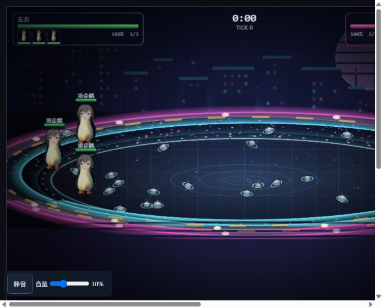
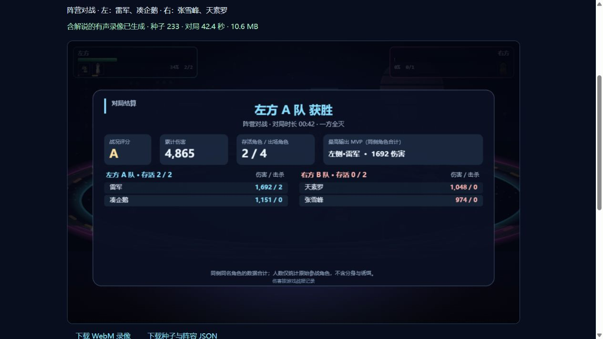
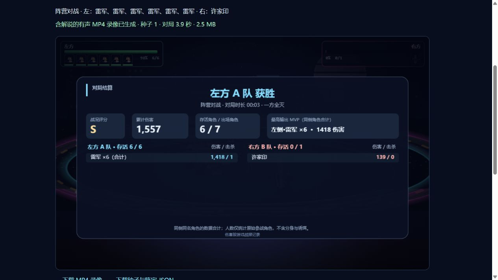
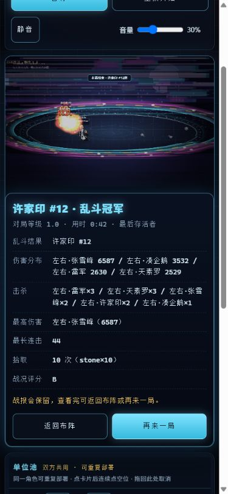

# 对战 AI 改进与验证

下方首轮结果对应提交 `2ac207f`；后续修正见文末。

## 行为变化

- 选敌综合考虑距离、前后排、剩余血量、无敌状态和附近队友目标；保留当前目标的适度优先级，减少来回换人。
- 技能先检查角色策略，再检查实际可用距离或资源；保留基础近战输出兜底，避免满血浪费纯防御、治疗技能和空库存落石。
- 张维为按队友血量治疗，六人团战也能救人；凑企鹅攒够可投掷的石头后会转入攻击。
- 技能时间轴和追踪弹道沿用锁定目标，目标死亡时重新选择；突进可沿二维方向追击后排。
- 远程单位根据最近威胁后撤；近战辅助不会因残血退出自身攻击范围。绕圈时按前方空间选择方向，避免靠墙逐帧反转。
- 闪避预测弹道是否真正接近命中，在场地内比较落点并避开敌方范围区域；闪避本身不造成伤害或获得命中怒气。

## 验证结果

验证日期：2026-10-19。Node.js v24.13.0；本地开发测试脚本位于被忽略的 `tools/_aicheck/`。

- `node --check js/ai.js`、`node --check js/engine.js`、`node --check js/fighters.js` 全部通过。
- `node tools/_aicheck/regression.js`：24 项通过。修改前代码在同一组断言中失败 19 项。
- `node tools/_aicheck/benchmark.js --before 80` 与 `node tools/_aicheck/benchmark.js 80`：1v1、3v3、6v6 各 80 场，使用相同阵容和种子 20000–20079。两版所有场次均在 180 秒模拟预算内结束。
- `node tools/_aicheck/matrix.js`：15 个角色（含 Boss）的全部有序 1v1 对位，种子 123、9876，共 450 场全部结束。225 组独立 VM 与 `lib/simhost.js` 回放的结果、统计和最终哈希一致。
- 另外验证暂停不推进状态、恢复后回放一致，以及模拟过程中坐标、血量和怒气保持有限数值。

| 240 场相同条件对照 | 修改前 | 修改后 |
| --- | ---: | ---: |
| 近战空挥 / 挥击次数 | 2374 / 7675 | 1288 / 6604 |
| 近战空挥率 | 30.9% | 19.5% |
| 开局误放近战技能次数* | 339 | 0 |

\* 统计前 60 tick 内马保国、熊猫头、大力哥的 `s1`；默认两军相距较远。空挥按引擎 `whiff` / `swing` 事件统计。模拟时长按 `tick / 60` 计，不使用界面计时作为测试预算。

## 验证边界

本次完成 690 个不同对战场景的无头逻辑验证，以及当前 JS 文件和观战页面的 HTTP 读取核对。启动带远程调试参数的 Edge 测试进程被自动审批拦截，因此没有完成浏览器渲染和实际观感验收。

角色数值未调整；决策改变可能影响对位胜率，本次结果不代表已重新完成平衡性调校。上述本地脚本与基线快照按仓库约定不随 Git 发布。

## 后续试玩修正：音量与远程站位

- 降低默认总音量至 30%，限制同名音效重触发、最多六个并发音效、台词每三秒一次，移除引擎与表现层重复播放施法/突进音效。主页面与测试台提供持久化的静音和音量控制。
- 许家印、罗翔等角色的旧普攻射程仅为 80～92，走位现按主攻弹道技能计算距离；丁真同样遵循远程停步距离。反僵死逻辑只适度压近，不再退化成近战距离。刺客和以近战起手的混合连段保留近身定位。
- `node tools/_aicheck/regression.js`：28 项通过，新增三个弹道角色在反僵死状态下保持距离，以及刺客/近战不被误分类的验证。
- 重跑 240 场随机阵容与 450 场全角色对位，均正常结束；225 组服务端/独立 VM 回放一致。240 场空挥率为 1397 / 6579（21.2%），开局误放近战技能仍为 0。
- `node tools/_aicheck/audio-regression.js`：8 项 Web Audio/DOM 桩检查通过，覆盖默认音量、重复/并发限制、采样增益、台词间隔、静音与设置恢复、存储不可用时降级；未进行实际听音或浏览器布局验收。

## 当前双角色版本与企鹅飞踢

角色池现仅保留 `tomori`（凑企鹅）与 `xujiayin`（许家印），其他角色及隐藏 Boss 已移除。上面的全角色结果属于历史版本；旧回归脚本依赖已删除角色，不适用于当前版本。

- 飞踢是独立的 `s3`：冷却 9 秒、蓄力 0.4 秒、范围 260、飞行 0.36 秒、最高跃起 65，不消耗怒气或石头；保留拾荒、丢石头和必杀。
- 引擎、AI、回放哈希、技能组装、角色倾斜姿态、起跳/落地表现与测试台冷却显示均已接入第三技能；受击中止或死亡时清理飞行状态。
- `node tools/_aicheck/two-fighter-regression.js`：12 项通过，覆盖双角色清单、高难度随机阵容、旧存档过滤、原技能保留、距离/冷却/封印、石头优先级、单次伤害/击退、飞行/落地、暂停及回放一致性。
- 随机压力模拟：1v1、3v3、6v6 各 80 场，共 240 场全部结束；多人压力场景使用两位角色的重复实体。另测两位角色的全部有序 1v1 对位、两个种子，共 8 场全部结束，4 组服务端/独立 VM 回放一致。
- 音频 8 项桩检查继续通过。保留两位角色贴图与专属语音、技能音效，移除其他角色素材及 Boss 专属音乐/吼声，共删除 67 个已跟踪文件。用户的账号数据、存档和未跟踪素材未删除。
- 尚未完成真实浏览器画面或听音验收；飞踢的跃起高度、倾斜姿态与落地状态已在逻辑/姿态检查中验证。

## 最新三角色与新技能版本

随后按用户要求加入张雪峰，当前角色池为凑企鹅、许家印、张雪峰；其余旧角色仍保持移除。双角色段落为此之前的阶段性结果。

- 张雪峰使用用户给定的透明 PNG（629×397），原样复制，SHA-256 为 `bc5de3eaafaffbced70fcf62cc47faefdd1578843a0f674f5cf6d6be6b57a3b8`，与 E: 盘原文件一致；未采用先前查找的网络照片或生成头像。技能为「跑步」「雪碧巧乐兹」，必杀为跑步的强化版「全力跑步」。
- 凑企鹅独立「企鹅飞踢」以及许家印独立「空城计」已接入。空楼诱饵是临时技能实体，可吸引附近目标；破坏/到时会伤害并挂债务，不攻击、不增加胜负存活人数。跑步、飞踢、后撤均采用二维突进。
- 修复护盾 buff 未给实体增加实际护盾值的问题，护盾按持续时间失效。
- `node tools/_aicheck/roster-skills-regression.js`：19 项通过，包含原技能保留、石头资源、飞踢、空城计召唤/后撤/诱敌/爆债/退场、张雪峰照片路径、跑步伤害、受伤补给、旧存档过滤以及暂停和回放一致性。
- 随机 1v1/3v3/6v6 各 80 场（多人压力测试允许重复角色实体），共 240 场全部结束；三角色全有序 1v1 对位、两个种子共 18 场全部结束；9 组服务端与独立 VM 回放一致。
- 全部 `js/*.js` 语法检查、Git 空白检查，以及 8 项音频桩检查通过。照片复制与透明通道已核对；未声称完成真实浏览器画面或听音验收。

## 当前四角色、共享布阵与管理员录像版本（2026-10-19）

当前角色为凑企鹅、许家印、张雪峰、天素罗。前面的两/三角色、无浏览器验收及“未调整数值”描述均为历史阶段；当前结果以 [角色平衡与模式验证](BALANCE.md) 为准。

张雪峰采用可见跑圈、15秒跑道、配速和冲线结算；天素罗使用用户提供的透明500×500原图，新增泡泡快递、泡泡陷阱、连锁啵啵。两张用户图片均与源文件SHA-256一致。共享角色池支持直接给双方部署、重复部署、占位替换、实例交换及撤下；明确开始按钮默认手动开战。乱斗各自为战，召唤诱饵继承归属，不影响最后存活者判定。

完成1440场换边平衡模拟、120场乱斗、240场随机压力对战、32场有序矩阵与16组宿主回放，均正常结束；27项技能、9项模式/布阵、8项音频、20项录像权限检查通过。真实浏览器已验证拖放与替换，实际下载了含正确时长的WebM录像，并核对录像JSON的最终模拟哈希。没有声称进行实际听音验收。

## 有声录像修正（2026-10-19）

前一版只录制Canvas并把音量设为零，导出为无声视频。现改为把游戏Web Audio总混音连接到录制音轨，与Canvas视频一起交给MediaRecorder；移除强制静音，并在录制期间隔离扬声器监听。开始录制时播放背景音乐，逐帧收集60Hz模拟事件供30fps画面和音效消费，避免漏掉中间帧或在结算阶段重复播放最后一帧音效。

浏览器自动音频未激活时明确提示点击开始，禁止静默导出；完成、取消或异常时清理音轨、停止音乐并恢复监听连接。9项音轨路由/激活/清理检查及原8项音频回归通过。实际下载种子123的WebM，包含960×600 VP9视频及48kHz双声道Opus音轨，总时长42.746秒。音轨平均音量-32.8dB、峰值-10.5dB，692帧音频解码通过（0 decode errors），中段也有非零音量；确认不是只有空白音轨。录像JSON仍复现最终哈希`c4df475b`。未声称完成主观听音评价。

## 雷军、SU7驾驶与贴图缩放（2026-10-20）

当前角色池增至五位。雷军采用用户提供的666×374透明PNG，原样复制后的SHA-256为`9ed089ee4951ae5d07b062105c09fb4a94a02b26ec6d8fe3bc1679fd18b92b25`，与源文件一致。场上贴图缩放为0.8；精灵尺寸现在也支持从内容框边界计算宽高，避免宽幅原图被挤瘦。手机和SU7由Canvas绘制。

- 音波命中打断蓄力，保留霸体、不可打断及无敌保护；手机每枚独立追踪命中实例，最多命中三个不同目标。
- 大招「SU7，启动！」上车后持续四秒，连续转向冲撞，接近场边时反射；同目标至少间隔39 tick伤害。驾驶期间霸体、可受伤，禁止其它施法，死亡、超时或胜负确定时立即下车。车辆跳过普通单位互斥，避免在人群或场边被挤住；仍使用路径段碰撞判定伤害。
- `node tools/_aicheck/leijun-regression.js`最终10项通过。五角色全部有序单挑、种子233和20261020共50场，以及10场混合1v1/3v3/6v6和6/12人乱斗均保持有限数值并自然结束；最长分别为70.5秒和41.43秒。
- 4个回放逐tick哈希一致，30个完整状态检查点一致；暂停时包含驾驶方向、目标、撞击冷却在内的状态静止，恢复只推进一个tick。独立右边界用例第2tick向内反射，第240tick下车。
- 原四角色solo/team/brawl各6个种子，共18组、47,212个tick与修改前引擎逐tick哈希和最终结果一致。JS语法与Git空白检查通过。
- 实际浏览器验证了第五张角色卡、常态0.8缩放、车窗内头像和车辆朝左时SU7文字正向显示。截图为种子233、雷军对张雪峰、第1220tick，浏览器哈希`d5b9e6fd`与无头引擎一致，该阶段截图已由文末记录的最终预览替换。本次没有重新录制视频或进行主观听音评价。

检查脚本和原始结果保留在被忽略的`tools/_aicheck/`；平衡抽样边界见[BALANCE.md](BALANCE.md)。

## 统一数值、AI协作与debug（2026-10-20）

所有模式现共用一套基础数值与技能参数，旧记录中的模式倍率、四角色胜率和裁图前文件哈希属于历史版本。最终属性、1270场独立种子复验和剩余克制关系见[BALANCE.md](BALANCE.md)，不能将“全部对战正常结束”解释为“所有角色完全平衡”。

AI新增可达打断窗口、泡泡叠层/过期/收割时机与同队必杀资源协调，选择技能失败不污染目标。固定相同测试属性的5v5开局，音波打断从0次变为1次，同一次完成泡泡必杀消耗印记由1层变为4层；普通自然对战效果依场景而异。seed32002的三天素罗对三企鹅重现了同队抢印记空大，修复后完成的空大从1次降为0次。

83项定向检查通过；最终数据下60场压力/矩阵检查正常结束，4个回放逐tick和完整状态一致。独立种子1270场全部自然结束，6个跨宿主回放逐tick哈希一致。真实浏览器完成拖放、交换、撤下、暂停继续、模式切换，并确认新PNG与SU7车窗头像显示正常，tick1789的浏览器哈希f97ab367与宿主一致。

渲染和测试台日志新增事件去重，不修改模拟事件或清空录像聚合队列。雷军贴图裁剪范围为原图[189,80,666,374)，成品477×294，SHA-256为05c7b28e02ae7e19ebf8900a8d49a362ebdacc3f26657b1c0828f3e7a17c05c2。人物RGBA逐点与源图对应区域一致，源文件不变；内容哈希查询参数解决旧图片缓存。常态绘制仍为0.8。

## 按存活凑企鹅数量供给石头（2026-10-20）

引擎815900b5b7d53f93：全场存活的原始参战凑企鹅数为N，开局生成8N块，地面补充目标10N块，每96tick（1.6秒）补充至多2N块且不超过缺口。只统计石头，不让其他拾取物占用预算；N为0时不生成。阵亡降低后续供给，已有石头保留至拾取或90秒过期，召唤物不增加供给。单挑、团战、乱斗完全共用规则，角色属性、库存上限和技能参数未改。修正浮点累加导致刷新延迟1tick的边界。

本地stone-population-regression.js专项11/11通过，结果见[stone-population-results.json](stone-population-results.json)。覆盖0/1/3/12企鹅、各模式和左右双方、缺口1、异类拾取物、阵亡及尸体移除、召唤物排除、精确96/192tick刷新、拾取半径/库存/过期。12组跨宿主回放共10800tick逐帧比较完整可变状态，包括地面石头、事件、随机数与刷新计时，一致。既有41项AI策略和12项统一属性/布阵/资源检查也通过；JS语法、Git空白检查通过。

实际浏览器用seed233、三企鹅对雷军/天素罗/张雪峰检查开局，tick0哈希a3d942cd，24块石头正常绘制；本地服务已重启并确认返回当前引擎。三个入口更新engine.js?v=23以刷新缓存。此改动未重新统计角色胜率，上节及BALANCE.md的1270场统计属于固定石头供给的旧版本。

## 录像自然语言解说、结算与本地配置（2026-10-20）

解说只在管理员录像导出中使用：同阵容/种子复盘提取真实事件，用户配置的兼容模型按事件ID生成自然中文，再调用MiniMax Speech云配音。默认预设MiniMax Token Plan，参数与API格式已核对官方文档，详见[COMMENTARY.md](COMMENTARY.md)。所有配音提前预载并用实际WAV时长排程，结局迟到时顺延录制结束，重放终局tick和hash必须一致。

已修复结算缺失的根因：网页DOM战报不在canvas.captureStream录制范围。新增独立Canvas完整结算卡，包含胜方/乱斗冠军、真实存活人数、MVP、伤害和击杀，重复角色同侧合计，至少停留5秒且等结局解说结束。

用户可显式把两套API密钥与模型/音色设置保存在当前浏览器localStorage，刷新自动恢复，可取消记住或清除。服务器和下载JSON不持久保存密钥。仅本地回环启动会建立用户指定的默认管理员，显式管理员配置优先，已有账号与隐藏固定管理员不改变。

战况17项、模型26项、云语音47项、服务权限/取消/时间轴24项、前端19项、结算Canvas9项、本地管理员12项、浏览器设置19项定向检查通过，共173项；另11项事件消费、12项统一属性与布阵回归通过。无新增依赖，语法与Git空白检查通过。模型/云语音接口验证使用本机HTTP替身，付费供应商调用0次。

真实浏览器完成独立管理员登录、填写模型及配音接口、导出有声WebM、保存下载文件、刷新恢复密钥。seed233（雷军/凑企鹅对张雪峰/天素罗，标准化前排站位）终局tick2542、hash0339fcc0，对战42.37秒；下载视频960×600、47.4秒，最后帧包含完整结算卡。实际解码音轨为48kHz双声道，整段RMS0.03415、结局解说区间RMS0.02618（初版1倍人声），非静音；最后解说结束44.582秒，完整保留到47.4秒。浏览器和下载视频结算截图保存于docs/img/commentary-result-preview.png及commentary-result-frame.png。

按用户反馈将解说单独提升至2.5倍（约8dB），播音期间音乐/音效分别降至20%/55%，结束或取消后恢复；现有游戏音量参数不变，前端回归已覆盖。真实MiniMax账户的鉴权/额度与主观音质须在用户填写密钥后确认，本地验收语音为测试fixture，不能作为云模型音质样例。

提高音量后再实录同一场，下载文件47.34秒，结局解说区间RMS0.05503（前版0.02618，实际混音约提高6.45dB），片头RMS0.06331，结局音轨完整。真实浏览器还验证了两套密钥保存、刷新预填和清除后输入框留空；默认本地管理员登录与导出权限正常。逐模块计数和源码哈希见[commentary-validation.json](commentary-validation.json)，共196项检查（173项本功能 + 23项既有回归）。

## MP4直接导出（2026-10-20）

支持时默认原生H.264/AAC MP4，另有WebM选项；按实际MIME确定扩展名/下载标签/JSON格式字段，不给MP4套用WebM时长补丁，编码能力在模型配音请求前检查。不支持时明确显示并预选WebM，不通过改扩展名伪装MP4。实际recorder脚本13项新增回归通过，包括编码失败、清理与容器一致性，累计209项检查。

真实浏览器导出短对局fixture（seed1，六雷军对一许家印，只验证导出而非平衡），终局tick231/hashba999c58。下载MP4为2654177字节，ftyp容器、avc1视频与mp4a音轨；960×600视频解码8.8613秒，最后一帧完整结算；AAC音轨实际解码为48kHz双声道8.8317秒，RMS0.04751，结局播音区间RMS0.05579，解说结束6.0666秒后仍保留结算。无需转码依赖。成品截图见下，详细数据已加入commentary-validation.json。

## 乱斗称谓与角色事实纠错（2026-10-20）

修复乱斗解说仍称A/B方的根因：事实提取不再把出场侧作为队伍，乱斗名单去除side/team/slot，开场、淘汰、状态与结局使用逐人血量和存活ID。提示词明确各自为战，最终口播校验常见A/B队、左右阵营、队友等误称及全角/空白变体；团战仍允许阵营解说。

为防止模型混淆角色，所有事件增加服务器核实的短事实statement。模型保留一次`{{event}}`并生成前后口语点评，服务端按当前事件还原准确施法者、被打断者、淘汰者和冠军。乱斗及重复角色用“角色名+实例号”朗读；槽外手写已知角色、技能或编号会被拦截。打断事件的技能属于被打断者，淘汰无已知归属时不补击杀者，大招没有目标字段时不编造受击对象。模式和身份错误共用一次纠正重试，仍不合格则在配音前停止，共享原60秒超时与取消信号。

本轮107项检查通过：战况17、模型26、乱斗与身份40、服务集成24。专项覆盖12人重复角色乱斗（seed20261020，tick2941/hash22214c79，冠军ID7）、错误SU7施法者、击杀主客反写、错误冠军及编号、未知或重复占位符、全角/裸#编号、混合错误共享重试上限、取消和鉴权脱敏。持续错误的真实服务任务只请求两次模型，配音请求0次且无音频残留；另验证了实际HTTP权限路由和前端控制器。六场逐tick事实复盘的终局hash、结果和tick均与原引擎一致，没有更改数值或战斗逻辑。

原始结果汇总与源码哈希见[commentary-brawl-validation.json](commentary-brawl-validation.json)。模型和语音均使用本机HTTP替身，付费供应商调用0次；本轮未重新实录视频。固定的是事件事实关系，自由点评仍由模型生成，未声称能识别所有自然语言语义错误。旧解说任务和已下载视频须重新生成，更新后重启Node服务加载新模块。

## 手机端完整结算与手动阅读（2026-10-20）

修复手机战报被画布容器裁切的问题：窄屏及矮横屏改为画布、完整战报、单位池依次排列，战报不限高度，长数据换行并随页面滚动。HUD按钮可换行，交互触点至少44px，权限标记移至页面末尾避免遮挡。服务器静态允许列表补上mobile.css，修正该文件此前HTTP404、只能依赖脚本注入旧样式的根因；响应式布局统一由CSS控制，去掉重复监听和全局双击拦截，保留实际画布拖拽保护及首次手势解锁音频。

摆阵时角色卡紧接画布和单位池标题，移到人数、自动开战与导出设置之前，改为单行横向滑动，避免最后两张卡离画面更远。320/390竖屏及844横屏实测画布底部到首卡顶部约49～51px，角色栏可独立横滑而页面无横向溢出。只调整布局，原始贴图、object-fit和角色图像缩放没有改动；预览见[手机布阵](img/mobile-placement-preview.png)。

手动玩家的战报持续保留，提供“返回布阵”和“再来一局”；自动模式及无布阵权限的观战者仍3秒连场。另修复人数分母依赖尸体清理的问题：按原始参赛者统计两侧出场人数，6v6剩3人显示3/6，不等人数分别计算；召唤物与诱饵不计入人数，评分也不再随尸体移除变化。仅修改战报统计，模拟状态、随机数与hash不变。手机导出设置改为单列、输入和按钮44px，长地址/状态可换行；录像仍为960×600。

本轮新增/相关回归46项通过：移动行为11、战报阅读15、人数统计11、既有Canvas结算9，连同上节解说107项共153项；7个变动JS模块语法检查及Git空白检查通过。真实浏览器验证320×740、390×844竖屏、844×390横屏均无横向溢出，报告为正常文档流且scrollHeight等于clientHeight，继续按钮高44px；1280×800桌面保持原布局。导出页320px下单列、全部可见输入/下拉/按钮44px，mobile.css实际HTTP200。完成一场普通对局并点击返回布阵，原6v6阵容保留；另以冻结截图模式检查乱斗冠军完整战报。

详细视口数据和源码哈希见[mobile-validation.json](mobile-validation.json)，截图见下及[手机导出设置](img/mobile-export-settings.png)。浏览器视口模拟不能代替真实手机Safari与触摸硬件验收，本轮未重新导出音视频或调用付费模型。

