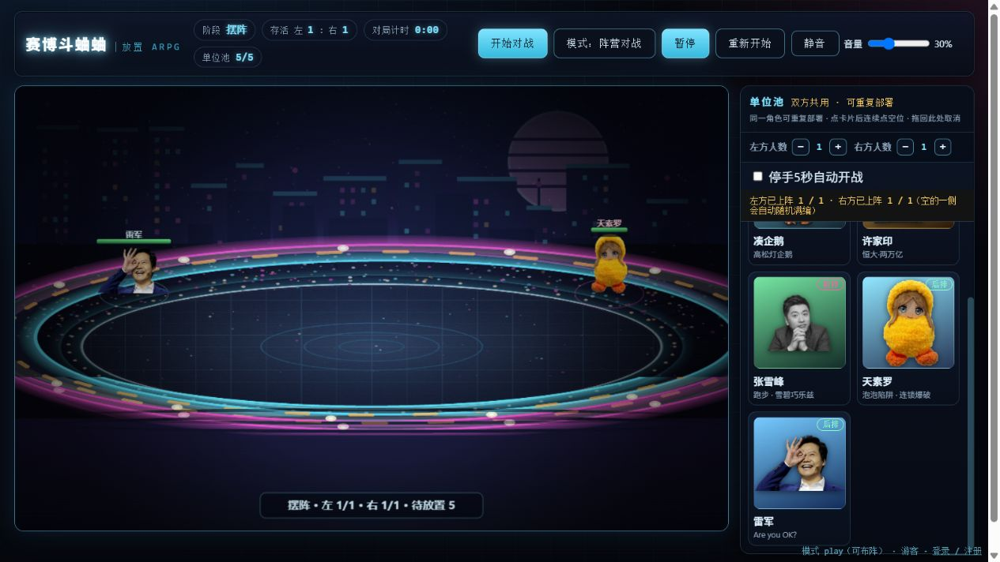

# 角色平衡与模式验证

2026-10-20，五角色统一数值首轮记录。原始种子、对位、参数与回放哈希见 [balance-five-results.json](balance-five-results.json)。此前四角色数据保留在 [balance-results.json](balance-results.json)，不代表当前版本。

后续已按用户要求将石头改为随全场存活参战企鹅数N刷新：开局8N块，地面补充目标10N块，每1.6秒最多补2N块且不超过缺口。没有存活企鹅时停止刷新，阵亡不删除已有石头，召唤物不增加供给。此规则各模式共用，角色数值未改。下文1270场胜率、83项回归及截图哈希来自调整石头前的版本，不能代表新资源规则的胜率。

## 共用一套数值

单挑、阵营团战与自由乱斗共用同一套生命、攻击、防御和技能参数。已删除模式专属生命/攻击倍率，前后排加成仍按站位计算，所有模式遵循同一规则。90组模式/人数/站位、600个实体的属性和完整技能数据比较通过。

| 角色 | 生命 | 攻击 | 防御 |
|---|---:|---:|---:|
| 凑企鹅 | 1850 | 146 | 88 |
| 许家印 | 1300 | 110 | 44 |
| 张雪峰 | 1320 | 78 | 52 |
| 天素罗 | 1300 | 91 | 56 |
| 雷军 | 1220 | 94 | 48 |

企鹅增加基础生存和输出；许家印小幅增加生命；张雪峰增加生存，跑道伤害从0.07/0.10调整为0.06/0.085，冲线系数从0.70/1.20调整为0.75/1.30，跑道仍持续15秒。天素罗生命提高至1300，连锁半径从145调整为220，单目标伤害和每个目标至多两次连锁的限制保留。

雷军音波系数从0.48调整为0.72，手机从0.42调整为0.34，SU7撞击从0.42调整为0.32，生命调整为1220。保留四秒驾驶、霸体可受伤、39tick同目标撞击间隔及0.8贴图缩放。提高单体输出、减少群体技能的收益，这些调整在所有模式中相同。

## 独立种子复验

最终参数使用未参与选择这组参数的种子：单挑和同角色3v3分别使用43000～43019，10组角色对位均交换左右，各400场；混合3v3/6v6分别使用68000～68007，各160场；5/10/12人乱斗使用78000～78049，各50场。共1270场全部自然结束，终局数值有限。

混编实验的双方使用相同队友，只替换一个槽位并交换左右。表中混编指标衡量替换槽位在这些阵容里的结果，不能解释为该角色任意上场时的个人胜率。

| 角色 | 单挑胜率 | 混编3v3替换槽指标 | 混编6v6替换槽指标 | 乱斗夺冠占比 |
|---|---:|---:|---:|---:|
| 凑企鹅 | 57.5% | 43.8% | 42.2% | 30.0% |
| 许家印 | 39.4% | 48.4% | 40.6% | 13.3% |
| 张雪峰 | 56.3% | 50.0% | 45.3% | 7.3% |
| 天素罗 | 63.7% | 53.1% | 54.7% | 20.7% |
| 雷军 | 33.1% | 54.7% | 67.2% | 28.7% |

调整石头前，同角色三人队的胜率为：凑企鹅29.4%、许家印56.9%、张雪峰70.6%、天素罗25.0%、雷军68.1%。当时企鹅共用固定的全场石头资源，同角色堆叠存在资源竞争；后续已改为按存活数量供给。同角色队与混编队的结果不应混为一谈。

| 乱斗规模 | 凑企鹅 | 许家印 | 张雪峰 | 天素罗 | 雷军 |
|---|---:|---:|---:|---:|---:|
| 5人 | 17/50 | 3/50 | 4/50 | 7/50 | 19/50 |
| 10人 | 12/50 | 11/50 | 4/50 | 11/50 | 12/50 |
| 12人 | 16/50 | 6/50 | 3/50 | 13/50 | 12/50 |

这是首轮跨模式的统一参数调整，并非所有对位五五开。仍有明显克制：雷军单挑偏弱、6v6替换槽收益偏高；张雪峰和许家印在这些乱斗场景中偏弱。乱斗按角色等量或轮换补足12人，轮换站位，但没有穷举所有站位和阵容。

## AI与debug

- 雷军按自己的前摇、音波飞行时间和敌方剩余蓄力决定能否抢断，实际选技成功后才同步走位与施法目标。
- 天素罗优先利用多层、多目标泡泡；过期、危急或收割时及时引爆。同队已有尚未完成的泡泡必杀时，其他人继续普通技能，避免抢同批印记空大。
- 渲染和观战日志按对局身份与事件序号去重，暂停、同tick重复绘制和战报不再重复播放最后一批事件，保留录像的聚合事件。
- 雷军PNG按非零透明度边界裁为477×294，原图对应区域的RGBA逐像素一致。资源路径增加内容哈希，避免一周图片缓存继续使用旧图。

41项AI策略、9项防重复空大、12项统一属性/布阵/存档/贴图、11项事件消费和10项技能/回放回归通过，共83项。额外60场逐tick数值检查正常结束，4组回放完整状态一致；上述1270场中的6组跨宿主回放逐tick哈希一致，暂停不推进模拟。脚本及中间实验按仓库约定保留在被忽略的tools/_aicheck/。

实机验证包括拖放替换、实例交换、拖回池撤下、重复部署、暂停继续及模式切换。最终SU7截图为seed233、雷军对张雪峰、tick1789，浏览器和无头引擎哈希同为f97ab367。未重新导出录像或进行主观听音评价。

